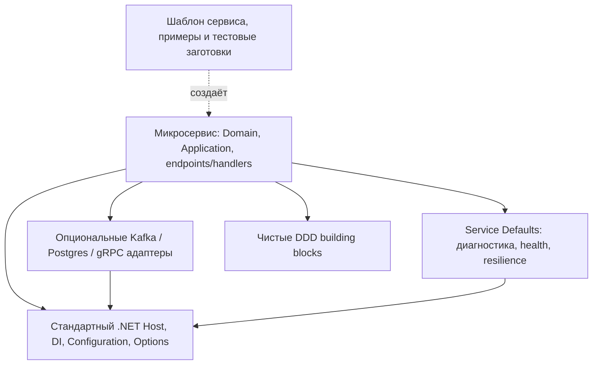

# Карта платформы — исключительно гипотезы

Статус: **неутверждённая схема, не структура будущих пакетов**.

## Разделение ответственностей для обсуждения

Схема показывает разделение ролей, а не окончательные ссылки между проектами. В частности, `Domain` не должен зависеть от Kafka, gRPC, EF Core, Serilog или startup/bootstrap.

## Конкурирующие подходы

| Подход | Почему стоит рассмотреть | Главный риск |
|---|---|---|
| Стандартный .NET + существующие библиотеки | Минимум собственной поддержки и привычные primitives | Повторение настройки между сервисами |
| Модульные NuGet-пакеты + defaults + шаблон | Выборочное подключение и единые правила | Рост количества пакетов и сложность совместимости |
| Собственный Platform bootstrap/framework | Короткий красивый DX | Магическое поведение, связанность и дорогие обновления |
| Готовая более широкая экосистема | Быстрое получение многих функций | License lock-in, package lock-in, чужие ограничения |

## Критичные сценарии, которые надо спроектировать

1. **HTTP + CQRS:** controller → validation/auth → handler → aggregate/domain → commit → response.
2. **Надёжная публикация:** domain event → integration contract → транзакционный outbox → публикация Kafka → фиксация результата.
3. **Потребление Kafka:** запись → проверка/десериализация → handler → идемпотентный durable effect → commit offset → retry/quarantine при сбое.
4. **gRPC:** конфигурация server/client → deadline/auth/tracing → обработчик → поведение при сетевых отказах.
5. **Worker:** Generic Host → проверка конфигурации → работа → cancellation/shutdown → метрики и health.

## Вопросы до проектирования API
- Нужен ли вообще тип `Platform`, или стандартный `builder.Services.AddX()` и service defaults дадут лучшую композицию?
- Должны ли handlers опираться на посредник/mediator или на минимальные интерфейсы и обычный DI?
- Будут ли скрытые настройки нарушать реальные гарантии Kafka/DB?
- Может ли сервис подключить только один модуль, не подтягивая остальные?
- Следует ли отделить Aspire AppHost для local orchestration от production deployment?
